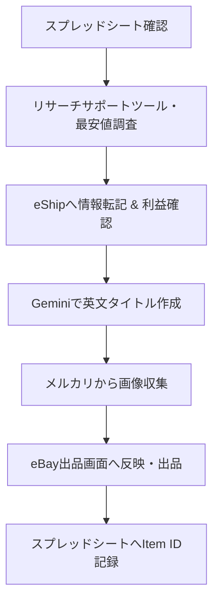

# 出品外注さん専用マニュアル

ようこそ！こちらは**eBay出品作業**を担当していただく外注スタッフ様専用のマニュアルです。

リサーチ担当者が選定した商品を、正確かつ魅力的な状態でeBayに出品し、スムーズに販売へつなげるための一連の手順をまとめています。

---

## 📌 出品作業の全体像

出品作業は以下の**3大ステップ**で進行します。

1. **仕入れ元・価格・利益の確認**
   - スプレッドシートから商品URLを開き、「ebayリサーチサポートツール」や各種拡張機能で最安値と利益（500円以上）を確認します。
2. **出品情報の作成・収集**
   - AI（Gemini）を活用してSEOに最適化された英語タイトル（80文字以内）を作成し、メルカリから綺麗な商品画像を収集します。
3. **eBay出品・記録**
   - eShipからeBayへ情報を転記し、状態や送料ポリシーを設定して出品完了後、Item IDを記録します。

---

## 🛠️ 事前準備（使用ツール一覧）

作業開始前に、以下のツール・拡張機能のログインや準備を完了させておいてください。

| ツール / 拡張機能 | 主な用途 |
| :--- | :--- |
| **Google スプレッドシート** | 納品データの確認、重量・リサーチ担当者名の取得、出品完了の記録 |
| **ebayリサーチサポートツール** | 仕入れ元ページからの送料・価格情報取得 |
| **Buy and sell all things on eBay** | eBay上の最安値（Sold / Active）のクイック検索 |
| **eShip（Chrome拡張機能）** | 商品情報の自動取得、利益計算、eBayへの出品情報転記 |
| **Google Gemini（AI）** | 売れる英語タイトル作成（80文字以内）、商品説明文作成 |
| **メルカリ** | 商品画像の収集（新品・未使用 / 売り切れから選定） |

---

## 🚀 マニュアルの進め方

- **まずは全体の流れをつかむ**:
  👉 [出品手順（STEP①〜⑦）](workflow.md) をご覧ください。1品を出品するまでの全手順が1ページにまとまっています。
- **迷ったとき・詳しいルールを確認したいとき**:
  👉 各ステップからリンクされている「詳細ガイド（仮）」や「よくある質問」を参照してください。
