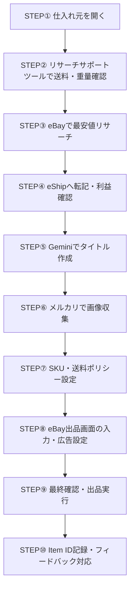

# 出品作業の一連の流れ（STEP①〜⑩）

このページでは、スプレッドシートを開いてからeBayへ出品完了し、Item IDを記録するまでの**全手順（STEP①〜⑩）**を1本の流れで解説しています。

日常の出品作業時は、このページを上から順に進めることでスムーズに作業を完結できます。

---

## 全体フロー概要



---

## <span class="step-badge">STEP①</span> 仕入れ元（Yahoo!フリマ等）を開く <span class="time-badge">0:10~</span>

### 📖 操作手順
1. 配布された**管理用Googleスプレッドシート**を開きます。
2. 作業対象行の **「J列（仕入れ元URL）」** にあるリンク（Yahoo!フリマなど）を確認します。
3. URLを右クリックし、「リンクを新しいタブで開く」で仕入れ元の出品ページを表示します。

> [!TIP]
> 複数タブを同時に開きすぎると混乱しやすいため、1商品ずつタブを管理して進めるのがおすすめです。

---

## <span class="step-badge">STEP②</span> ebayリサーチサポートツールで送料・重量確認 <span class="time-badge">0:27~</span>

### 📖 操作手順
1. 仕入れ元ページ（Yahoo!フリマ）を開いた状態で、Chrome拡張機能 **「ebayリサーチサポートツール」** のアイコンをクリックします。
2. 表示されたポップアップ画面で **「送料を取得」** をクリックします。
3. スプレッドシートの **G列（商品重量）** に記載されている数値（例: `202` [g]）を確認し、ツールの「重量」入力欄に正確に入力します。

> [!WARNING]
> **重量の入力ミスに注意！**  
> 重量がずれると送料計算が狂い、赤字出品の原因になります。スプレッドシート記載のグラム数（g）を正確に入力してください。

---

## <span class="step-badge">STEP③</span> eBayで最安値リサーチ（Sold & Active） <span class="time-badge">0:53~</span>

### 📖 操作手順
1. Chrome拡張機能 **「Buy and sell all things on eBay」** をクリックし、eBayの検索ページを開きます。
2. **Sold Listing（販売済み）の確認**:
   - フィルターで **「Japan」** を選択し、日本セラーの販売履歴に絞り込みます。
   - 出品対象と**完全に同一の商品**の最安値を確認します。
3. **Active Listing（出品中）の確認**:
   - 現在出品中の最安値商品を特定し、その商品ページを開きます。

> [!IMPORTANT]
> **検索キーワードの確認**  
> ツールが自動抽出したキーワードがずれていると、別商品が表示されることがあります。商品名や画像を確認し、必要に応じて手動でキーワードを微調整してください。  
> 詳しい判断基準は [eBay最安値の特定と判断基準（Sold/Active・キーワード調整）（仮）](guide_ebay_research.md) を参照してください。

---

## <span class="step-badge">STEP④</span> eShipへ情報転記 & 利益確認（500円ルール） <span class="time-badge">1:29~ / 3:35~</span>

### 📖 操作手順
1. eBayの出品中（Active）最安値ページを開いた状態で、Chrome拡張機能 **「eShip」** をクリックします。
2. **「商品情報取得」ボタン（電球アイコン）** をクリックします。
   - eBay URL、Item ID、商品名、最安値、送料、カテゴリIDなどが自動転記されます。
3. eShipポップアップ下部の **「eShip転記」** ボタンを押し、利益計算ページへ移動します。
4. **利益額が「500円以上」** あることを必ず確認します。

> [!CAUTION]
> **利益500円未満は出品ストップ！**  
> 利益が500円を下回る場合は出品を見送るか、管理者・リサーチ担当者へ確認してください。確認せずにそのまま出品することは厳禁です。

---

## <span class="step-badge">STEP⑤</span> Gemini（AI）でSEOタイトル作成（80文字） <span class="time-badge">3:51~</span>

### 📖 操作手順
1. Yahoo!フリマの日本語商品名をコピーします。
2. **Google Gemini** を開き、専用プロンプトで英語タイトルを作成します。
   - **指示プロンプト例**:
     ```text
     [日本語商品名]
     あなたはebay物販のコンサルタントです。SEOを意識し、この商品の売れるebay titleを80文字以内で作成してください。
     ```
3. 生成された英文タイトルをコピーし、eShipの「商品名」欄に貼り付けます。
4. **【最重要】文字数が80文字以内** に収まっていることを確認します。オーバーしている場合はGeminiに「文字数が多いので80文字以内に短縮して」と指示して再生成します。

> [!TIP]
> タイトルにはブランド名、モデル型番、対応機種、カラー、キャラクター名などが漏れなく入っているか確認しましょう。  
> 詳しいプロンプト集は [Geminiを使ったタイトル作成テクニック（80文字調整・プロンプト集）（仮）](guide_gemini_title.md) をご覧ください。

---

## <span class="step-badge">STEP⑥</span> メルカリから画像収集・eShipへ登録 <span class="time-badge">4:49~</span>

### 📖 操作手順
1. **メルカリ** で商品名を検索し、絞り込み条件で **「新品・未使用」**、販売状況で **「売り切れ（SOLD）」** にチェックを入れます。
2. パッケージや本体が綺麗に、鮮明に写っている画像を**複数枚（推奨2枚以上）**選定します。
3. 画像をPCにダウンロードします（画像ダウンロード拡張機能などの活用を推奨）。
4. eShipのポップアップ画面にダウンロードした画像をドラッグ＆ドロップしてアップロードします。

> [!NOTE]
> 外注先スタッフ様が魅力的な画像を選ぶことで、売れ行きが大きく変わります。商品全体、裏面、付属品がわかる画像を選定してください。

---

## <span class="step-badge">STEP⑦</span> Custom Label（SKU）とShipping Policy設定 <span class="time-badge">5:15~ / 5:34~</span>

### 📖 操作手順
1. **Custom Label (SKU) の入力**:
   - スプレッドシート **B列（リサーチ担当者名）**（例: `yukan`）をコピーし、eShipの「Custom Label (SKU)」欄に貼り付けます。
2. **Shipping Policy の選択**:
   - スプレッドシートの **「送料設定」タブ** を開きます。
   - 出品価格（ドル）を入力し、算出された推奨ポリシー名（例: `**EXP SpeedPak Ex $75-99.9`）をコピーしてeShipの「Shipping Policy」欄に貼り付けます。
3. **重量設定**:
   - パッケージ重量欄に指定の数値（例: `2`）、単位に **`lbs`** を選択します。

> [!IMPORTANT]
> 詳しい判定ルールは [Shipping Policyと重量の選び方（価格帯ごとの判定ルール）（仮）](guide_shipping_policy.md) を確認してください。

---

## <span class="step-badge">STEP⑧</span> eBay出品ページへ転記・Item Specifics・広告設定 <span class="time-badge">6:22~ / 7:15~</span>

### 📖 操作手順
1. eShip下部の **「Listing転記」** ボタンをクリックし、eBayの出品画面を開きます。
2. **Condition（状態）**:
   - 新品の場合は **「New」** を選択。中古の場合は **「Used」** を選択し、詳細説明文を記載。
3. **Item Specifics（商品詳細項目）**:
   - 「Suggested item specifics」を「Apply all」で一括適用。
   - 必須項目（Platform, Model, Item Weight等）を埋めます。
   - **`Country of Origin` は必ず「Japan」** を選択。
   - 不明な項目は「Does not apply」または「N/A」を選択。
4. **画像のトリミング・調整**:
   - 余白が多い画像はトリミングし、明るさを整えます。
5. **広告設定（Promoted Listing）**:
   - Generalタブで **「Listing ad rate」を必ず「2%」** に設定します。

> [!IMPORTANT]
> 状態説明や必須項目の選び方は [Condition（状態）とItem Specificsの入力ルール（仮）](guide_item_specifics.md) を参照してください。

---

## <span class="step-badge">STEP⑨</span> 最終確認・出品実行（List it） <span class="time-badge">8:19~</span>

### 📖 出品前チェックリスト
出品ボタンを押す前に、以下の項目を上から下まで再確認します：

- [ ] タイトルが80文字以内で、適切な英文になっているか？
- [ ] 画像が複数枚、鮮明にセットされているか？
- [ ] 利益が500円以上取れているか？
- [ ] Custom Label（リサーチ者名）が入っているか？
- [ ] Shipping Policyが合っているか？
- [ ] Item Specificsの `Country of Origin` が「Japan」になっているか？
- [ ] Promoted Listing が「2%」になっているか？

確認完了後、ページ下部の **「List it」** ボタンをクリックして出品を実行します。

---

## <span class="step-badge">STEP⑩</span> Item IDの記録・フィードバック対応 <span class="time-badge">8:30~ / 8:40~</span>

### 📖 操作手順
1. 出品完了画面に表示される **「Item ID（数字の羅列）」** をコピーします。
2. 管理スプレッドシートの該当行 **「出品状況」列** にItem IDを貼り付けます。
3. リサーチ担当者から修正依頼やコメントが入っていた場合は、内容を確認して速やかに修正を行い、**日付入りで返信コメント** を記入します。

> [!TIP]
> コメントの返信方法や修正ルールは [リサーチ担当者からのフィードバック対応とコメント返信（仮）](guide_feedback.md) をご覧ください。
