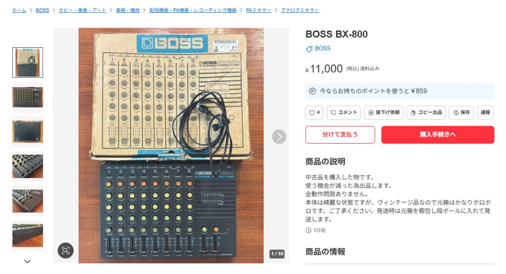
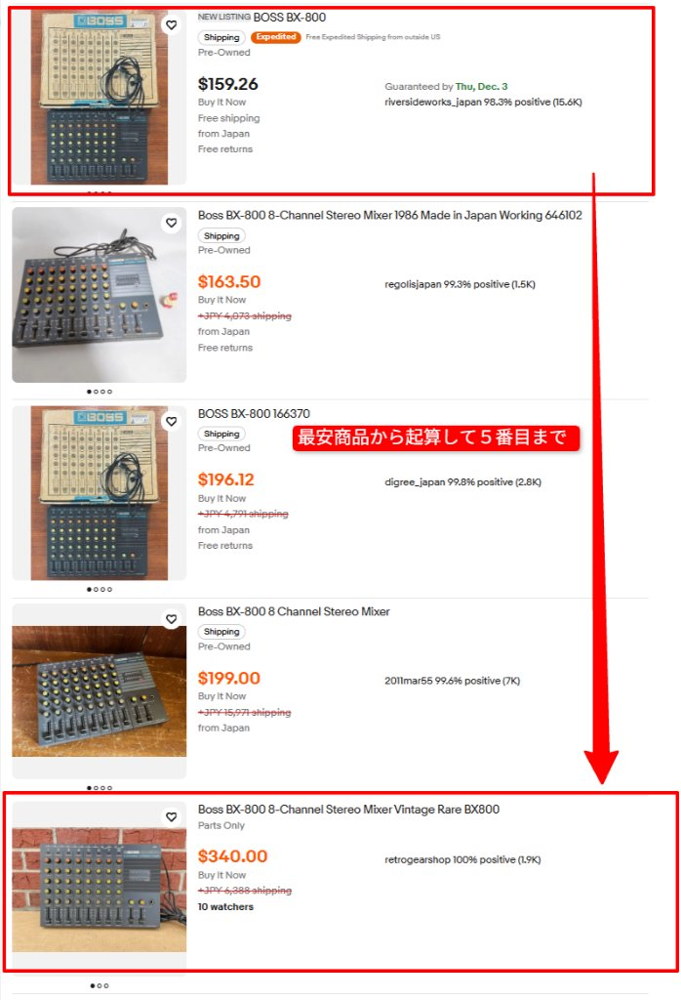
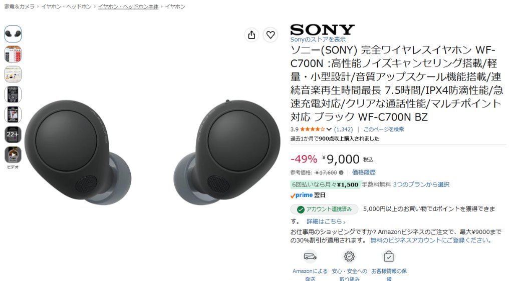
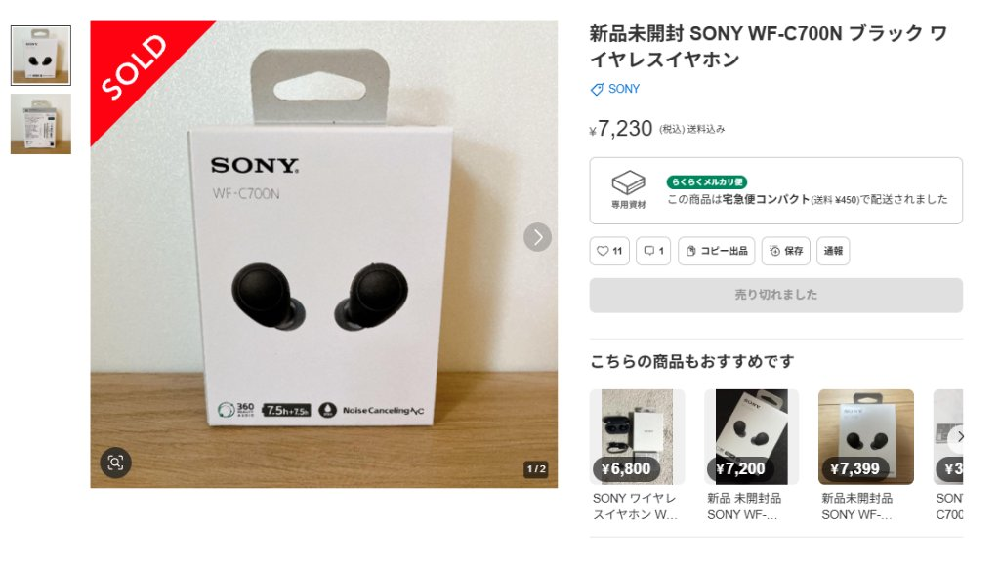
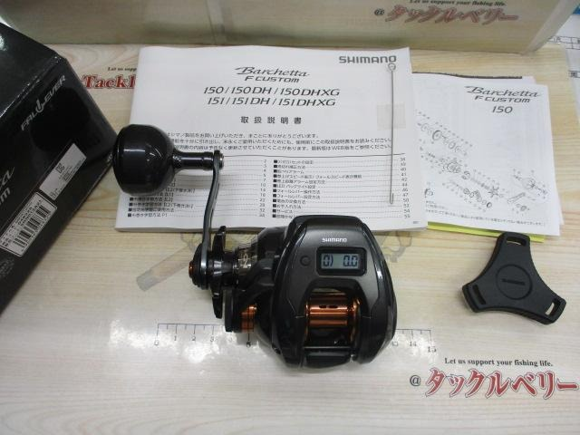

# 代替画像について

リサーチおよびリストアップの際は、必ず本ページの基準に沿って商品画像を確認してください。

「代替画像が見つからなかったらそのままでよい」という対応は廃止となりました。  
仕入れ元の画像がそのまま使えない場合は、以下の手順に沿って画像の差し替えと、スプレッドシート備考欄での共有をお願いします。

---

## 画像の差し替えが必須になる3つの条件

仕入れ元の1枚目に設定されているトップ画像が、以下の3つのうち1つでも当てはまる場合は、そのまま使わずに必ず差し替え対応を行ってください。

### ① ライバルと画像が全く同じ場合

eBayで同じ商品を検索した際、最安値から数えて5番目までの出品に全く同じ1枚目のトップ画像が使われている場合です。

たとえば、以下のような仕入れ元の商品を見つけたとします。

この商品をeBayで検索した際、下の画像のように最安の商品から5番目までの間に、仕入れ元と全く同じ1枚目の画像を使っているライバルがいる場合は、そのまま使うのではなく必ず別の画像へ差し替えてください。

### ② 実物写真ではない新品のプロモーション画像

メーカー公式サイトの宣材写真や、CG・白背景で綺麗に加工された新品のカタログ画像が使われている場合です。

たとえば、AmazonなどのECサイトを仕入れ元にする際、以下のようなメーカー公式のプロモーション画像が1枚目に設定されていることがよくあります。

このような宣材写真はそのまま使わず、フリマサイトの売り切れ商品などから、実際に撮影された新品未開封の実物写真を探して差し替えてください。

### ③ 透かしや他社ロゴが入っている場合

画像の中にショップ名、無断転載禁止の文字、他社サイトのロゴや透かしなどが入っている場合です。

たとえば下の画像のように、右下などにショップのロゴや透かし文字が入っている画像はそのまま使えないため、必ず別の実物画像へ差し替えてください。

---

## 代替画像の探し方

上記の3つの条件に当てはまった場合は、1商品あたり1〜2分を目安に、以下の優先順位で代替画像を探してください。

### ① フリマサイトの売り切れ商品から探す

メルカリ、ヤフオク、ラクマ、Yahoo!フリマの売り切れ商品から同じ商品を検索し、一般の出品者が撮影した実物写真を探します。

### ② Googleレンズで画像検索して探す

Google画像検索を使って、個人ブログやレビューサイト、海外のオークション履歴などから実物写真を探し、見つかった場合はそれを採用します。

検索結果の一覧に表示される小さなサムネイル画像は画質が粗いため、必ずリンク先の元ページを開いてから高画質な画像を選択してください。

⚠️ eBayのサイト内から画像を引用することはNGです。必ずeBay以外のサイトから探してください。

---

## 代替画像を選ぶ際の注意点

すべての画像を差し替える場合は、仕入れ元の商品と付属品、色、状態がおおむね一致している画像を選んでください。たとえば、仕入れ元の商品に元箱がないのに、箱が写っている画像を選ぶのはNGです。

お客様は代替画像を見て購入しますが、実際に届くのは仕入れ元の商品です。  
届いたときに「写真よりボロい」「写真にあった付属品がない」といったマイナスのギャップが生じると、即クレームや返品に直結してしまいます。

代替画像を選ぶ際は、必ず以下の2つの基準を守ってください。

### ① 状態は仕入れ元と同等か、少し使用感があるものを選ぶ

❌ NGな選び方

仕入れ元の商品には傷があるのに、新品のようにピカピカな代替画像を使うこと。実物が届いたときにガッカリされてしまいます。

⭕ OKな選び方

仕入れ元と同じくらいの状態か、むしろ少し使用感がある画像を選ぶこと。写真より実物の方が綺麗であれば喜ばれます。

### ② 付属品は仕入れ元と同じか、少ないものを選ぶ

❌ NGな選び方

仕入れ元には無い元箱、説明書、ケーブル、ケースなどが写っている代替画像を使うこと。「写真にあった付属品が入っていない」とクレームになります。

⭕ OKな選び方

仕入れ元と全く同じ付属品か、本体のみ・主要な付属品だけが写っている画像を選ぶこと。写真より実物の付属品が多ければ喜ばれます。

💡 どちらにするか迷ったときは、写真より実物の方が状態が良く、付属品が多いと感じてもらえる方を選んでください。

---

## トップ画像のみの差し替えについて

以下のようなケースでは、すべての画像を差し替えるのではなく、1枚目のトップ画像のみを差し替える対応も可能です。

- 中古の一点物で特殊な傷や使用感があり、全画像を別商品のものに差し替えると実際の状態と変わってしまう場合
- 代わりになりそうな画像が1枚分しか見つからない場合
- 付属品が完全に一致する画像が見つからない場合

この場合は、メインとなる本体のみが写っている画像や、すべての付属品が写っていなくても主要な付属品が綺麗に写っている画像を1枚目用として1枚だけ見つけてください。代替画像のページ内で2枚目や3枚目に良い写真がある場合は、その写真を1枚目用として指定しても構いません。

2枚目以降は仕入れ元の画像をそのまま使うことで、実際の付属品や細かい状態をすべて見せる形でカバーします。

---

## スプレッドシートへの記入ルール

画像の差し替えや例外対応を行った場合は、出品担当者が作業漏れや判断迷いを起こさないよう、スプレッドシートの備考欄に状況をわかりやすく記載してください。

- **すべての画像を代替画像に差し替える場合**  
  備考欄に「全画像を代替画像へ差し替えお願いします」と記入する
- **1枚目のトップ画像のみ差し替える場合**  
  備考欄に「1枚目のみ代替ページの〇枚目の画像へ差し替え、2枚目以降は仕入れ元の画像でお願いします」と記入する

### 1〜2分探しても適切な実物画像が見つからない場合

1〜2分探しても条件に合う実物画像が1枚も見つからない場合は、無理に探し続けず、状況に合わせて以下のように備考欄へ記入してください。

- **背景の白抜きや画像の切り抜きで対応できる場合**  
  備考欄に「画像編集をお願いします」などと記入する
- **代替画像がどこにも存在しない場合**  
  備考欄に「代替画像が見つかりませんでした」など、代替画像が無かった旨を記入する

